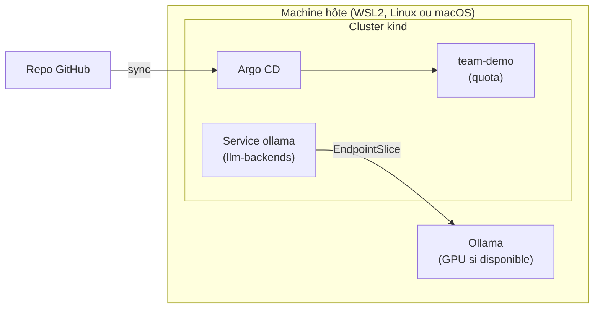

# ai-platform-lab

Une plateforme interne Data/IA en self-service sur Kubernetes, construite pas à pas pour monter en compétence en platform engineering. Elle tourne entièrement en local (kind), sans compte cloud ni clé API.

Le projet suit les thèmes du [programme de KCD Provence 2026](https://cloudnative-provence.fr/fr/programme) (10 décembre, Aix-en-Provence) : plateforme self-service, gateway LLM, GitOps, sécurité des clusters, observabilité.

## Ce que fait la plateforme (cible)

Une équipe décrit son service dans un court fichier `service.yaml`. La plateforme fournit le reste :

- un namespace avec quotas et règles réseau ;
- un déploiement GitOps (Argo CD) ;
- l'accès à un LLM local (Ollama) via une gateway compatible OpenAI, avec budget de tokens par équipe et bascule entre backends ;
- des garde-fous (Kyverno) et un scan des images (Trivy Operator) ;
- l'observabilité (OpenTelemetry, Grafana).

L'avancement est suivi dans [ROADMAP.md](ROADMAP.md) et les décisions dans [docs/adr/](docs/adr/).

## Architecture actuelle



## Profils de machine

Le même repo tourne sur plusieurs machines. Seul le profil change.

| Profil | Machine visée | Cluster kind | Usage |
|---|---|---|---|
| `laptop` (défaut) | 16 Go de RAM, WSL2 plafonné à 10 Go, GPU 4 Go | 1 nœud | Couches activées une à une |
| `workstation` | 32 Go de RAM ou plus | 1 plan de contrôle et 2 workers | Toutes les couches ensemble, tests multi-nœuds |

Détails et passage d'une machine à l'autre : [docs/PORTABILITE.md](docs/PORTABILITE.md).

## Prérequis

- Docker Engine (sous Windows : dans WSL2, voir [docs/WSL2.md](docs/WSL2.md))
- [kind](https://kind.sigs.k8s.io/docs/user/quick-start/#installation), [kubectl](https://kubernetes.io/docs/tasks/tools/), git, curl, make
- Pour `make validate` : [kubeconform](https://github.com/yannh/kubeconform) et, si possible, shellcheck
- À partir de la semaine 3 : [Ollama](https://docs.ollama.com)

## Démarrage

```bash
git clone https://github.com/<votre-compte>/ai-platform-lab.git ~/ai-platform-lab
cd ~/ai-platform-lab
cp profiles/local.env.example profiles/local.env   # puis renseigner REPO_URL

make preflight            # vérifie la machine
make up                   # profil laptop
make status
make argocd-password && make argocd-ui            # interface sur https://localhost:8443
```

Sur une machine plus puissante : `make up PROFILE=workstation`.

`make help` liste toutes les commandes. `make down` supprime le cluster ; tout l'état utile est dans Git.

## Structure

```
cluster/          configurations kind, une par profil
profiles/         variables par profil (+ local.env, propre à la machine, ignoré par Git)
gitops/
  bootstrap/      application racine d'Argo CD
  base/           ressources communes à tous les profils
  profiles/       ce qu'Argo CD synchronise pour chaque profil
scripts/          preflight, up, down, status, llm-check, validate
docs/adr/         décisions d'architecture
```

## Méthode de travail

Le code est écrit avec l'aide de Claude Code, selon une méthode inspirée du talk « L'IA sur des rails » (SNCF) : intention précisée, décisions tracées en ADR, plan validé avant d'implémenter, objectifs vérifiables (CI, `make validate`). Les règles données à l'agent sont dans [CLAUDE.md](CLAUDE.md).

## Données

Ce repo est public. Il ne contient et ne traite que des données synthétiques.
